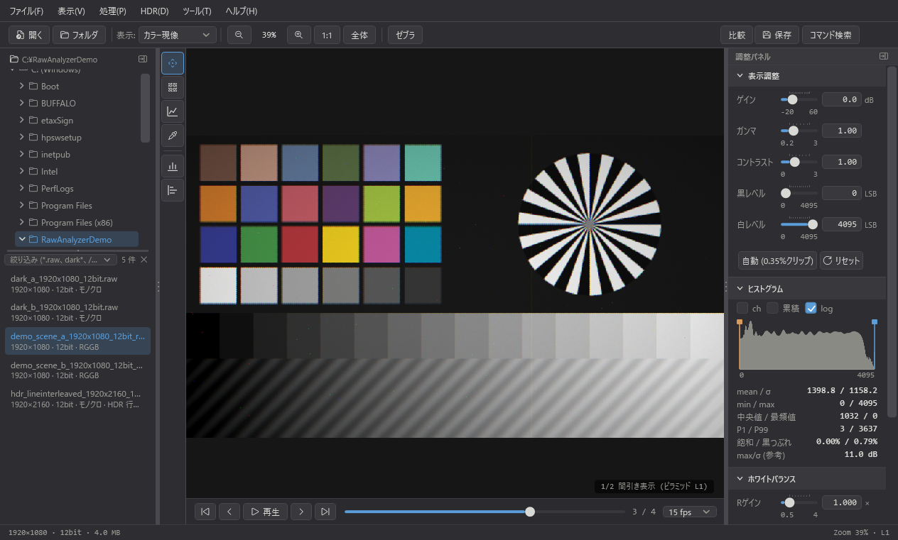
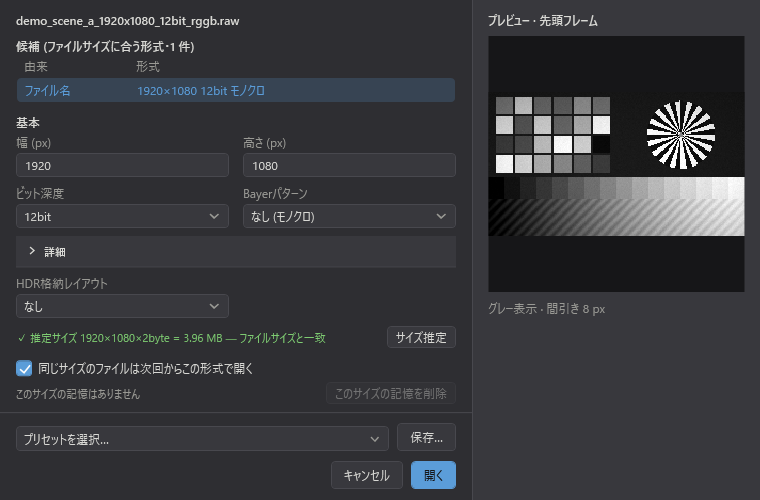
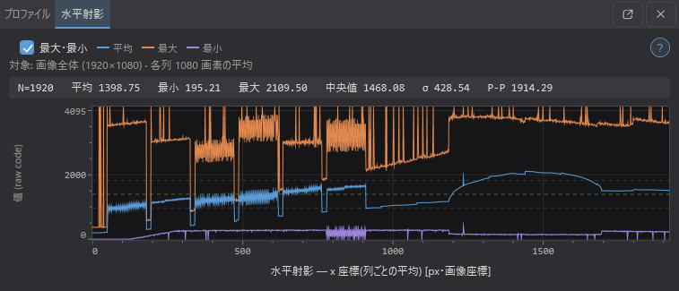
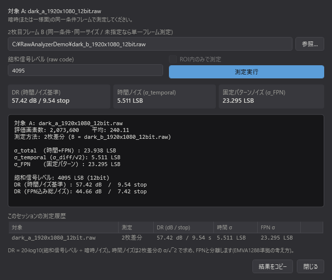
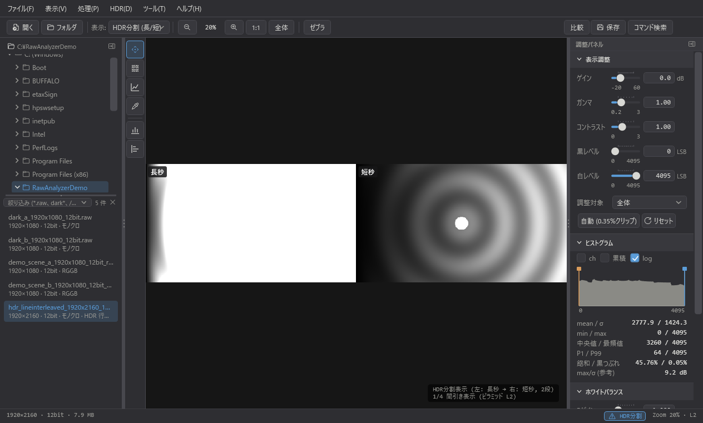
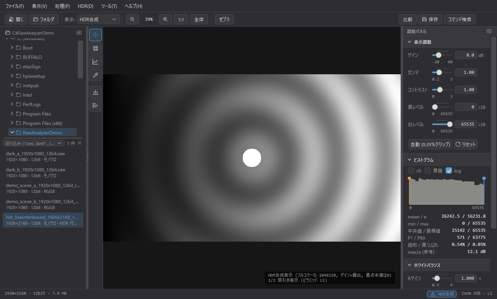

# RawAnalyzer

イメージセンサの Raw 画像を表示・評価する Windows デスクトップアプリです。
.NET 8 / WPF 製で、外部パッケージに依存しません。



- ヘッダのない Raw を、幅・高さ・ビット深度・詰め方向・エンディアン・オフセットを指定して開く
- ヒストグラム・統計、ラインプロファイル、水平・垂直射影、ノイズ / ダイナミックレンジ、欠陥画素を測る
- ライン交互 HDR を分割・合成する。最大 10 億画素の画像も UI を止めずに扱う

## ダウンロード

**[最新版](https://github.com/ToshikiTsuboi/RawAnalyzer/releases/latest)** の `RawAnalyzer-<version>-win-x64.zip` を展開し、
`RawAnalyzer.App.exe` を実行します。インストールも .NET ランタイムも不要です(Windows 10 / 11 64bit)。

- 設定は `%AppData%\RawAnalyzer` に保存されます。アンインストールはフォルダの削除だけです
- 未署名のため、初回は SmartScreen の「詳細情報」→「実行」で起動してください

## 使い方

### Raw を開く

`Ctrl+O`、ツールバーの「開く」、またはドラッグ&ドロップで設定画面が出ます。
JPEG / PNG / TIFF / BMP / DNG は設定なしで開きます。



- 上部の**候補**には、ファイルサイズに合う設定が一覧で出ます(ファイル名の `1920x1080` などの表記も使います)。選ぶと全項目に入ります
- 右側の**プレビュー**は、入力中の設定で先頭フレームを読んだものです。幅やビット深度が違うと絵が崩れるので、開く前に確かめられます。
  下部の推定サイズが実ファイルサイズと一致すれば、並びはひとまず合っています
- 詰め方向・エンディアン・ヘッダオフセット・フレーム数は「詳細」にあります。HDR の項目は格納レイアウトを選ぶと出ます
- よく使う設定は「保存…」で**プリセット**にできます。一度開いた設定は記憶し、同じサイズ・拡張子のファイルも次回から設定画面なしで開きます。
  違っていたら `F2` で開き直して修正します
- 左下のファイル一覧は、拡張子・ワイルドカード(`dark*`)・正規表現(`/^img_\d{3}\.raw$/`)で絞り込めます(`Ctrl+F`)

### 見え方を整える

右パネルの調整は表示だけを変え、画素データは書き換えません。

- `Ctrl+A` **自動コントラスト**(上下 0.35% をクリップ)、ゲイン(−20〜+60 dB)、ガンマ、コントラスト、黒 / 白レベル。
  黒 / 白レベルは、ヒストグラム上のハンドルをドラッグしても変えられます
- `Z` **ゼブラ**で飽和(最大コードの 98% 以上)と黒つぶれを縞表示
- 3200% 以上に拡大すると画素値を重ねて表示。`Ctrl+矢印` で画素カーソルを動かし、値をステータスバーで追えます

| キー | 表示モード |
|---|---|
| `Ctrl+1` | Raw(画素値そのままのグレー) |
| `Ctrl+2` | Bayer カラー(デモザイクなし) |
| `Ctrl+3` | カラー現像(デモザイク + WB + カラーマトリクス) |
| `Ctrl+4` | チャネル分割(R / Gr / Gb / B を 2×2 に並べる) |
| `Ctrl+5` / `Ctrl+6` | HDR 分割 / HDR 合成 |

### 測る

右パネルには常にヒストグラムと統計(mean, σ, min/max, 中央値, 最頻値, P1/P99, 飽和率, 黒つぶれ率)が出ます。
キャンバス左側のツールで「ROI」を選んで範囲を囲むと、その中だけの統計になります。

| 機能 | 操作 | 内容 |
|---|---|---|
| ラインプロファイル | キャンバス左側の「ラインプロファイル」→ 画素をクリック | クリック位置を通る行・列の断面 |
| 水平 / 垂直射影 | `H` / `V` | ROI か画像全体の列・行ごとの平均と最大・最小(EMVA 1288 の向き)。列 / 行 FPN、シェーディングを見る |
| ノイズ / DR | ツール → ノイズ / ダイナミックレンジ測定 | 同条件の暗時フレーム 2 枚の差分から σ_temporal = σ(A−B)/√2 と σ_FPN を分離し、DR を算出 |
| 欠陥画素 | ツール → 欠陥画素検出 | mean ± Nσ を外れた画素を全画素走査で検出。平均 / メディアン補間で補正、CSV 出力 |

 

ラインプロファイルと射影のグラフは、画像の下のドックにタブで並びます。別ウィンドウに出して並べることもできます。
グラフにポインターを置くと、その位置の値を読み取れます。
グラフはホイールで拡大(`Shift` で横軸のみ、`Ctrl` で縦軸のみ)、ドラッグで移動、ダブルクリックで全体表示に戻ります。
軸を右クリックすると範囲・目盛間隔・目盛線を設定できます。データは CSV / TSV で出力できます。

> ノイズ測定は暗時か一様面のフレームで行ってください。絵柄があると、その濃淡が σ_FPN に乗ります。

### HDR を分割・合成する

長秒と短秒が行ごとに交互に入った Raw(DOL / Staggered など)と、フレーム連結の HDR を扱えます。
開くときに **HDR 格納レイアウト**と露光比を指定し、`Ctrl+5` で露光ごとに左右に並べ、`Ctrl+6` で 1 枚に合成します
(長秒の飽和部を短秒 × 露光比で置き換え)。

 

読み出し遅延で短秒側が縦にずれるセンサは**行オフセット**、物理ライン単位で露光を切り替えるセンサは**ライン単位**で整列させます。
行交互 HDR の測定(射影・ノイズ・欠陥画素)は、HDR 分割ビューで段の中に ROI を置いて行います。

### 処理・保存

- **処理**メニュー: デジタルビニング(2×2〜8×8、平均 / 加算、Bayer の CFA 配列を保持)、空間フィルタ
  (平均・ガウシアン・メディアン・アンシャープ・Sobel・最小・最大)、画像演算(ダーク減算・フラット補正)。
  ビニングとフィルタは、適用前と適用後をプレビューで見比べてから適用できます
- `Ctrl+S` で Raw / 16bit TIFF / PNG / JPEG / float raw に保存。表示 LUT・WB・マトリクス・デモザイクを焼き込むか個別に選べ、
  何を焼き込んだかをサイドカーに記録できます
- `Ctrl+B` でフォルダ一括の現像と、連番・マルチフレーム・TIFF スタックからの動画書き出し(MJPEG AVI / MP4 H.264)
- ツールバーの「比較」で最大 4 枚を並べ、視野・表示条件を同期して比較。右パネルで選択中の画像の見え方を調整でき、
  カーソル位置の画素値を全画像ぶん並べて読めます

### キーボード

`Ctrl+Shift+P` のコマンドパレットで全機能を検索・実行でき、`F1` でショートカット一覧が出ます。

| キー | 操作 |
|---|---|
| `矢印` / `Shift+矢印` | パン(1/8 画面 / 1 画面) |
| `Ctrl+矢印` / `Ctrl+Shift+矢印` / `Ctrl+Alt+矢印` | 画素カーソルを 1 / 10 / Bayer 同色 2 画素移動 |
| `+` / `-` / `0` / `1` | ズームイン / アウト / 全体表示 / 等倍 |
| `PageUp` / `PageDown` / `Space` | 前後のフレーム / 再生・停止 |
| `F2` | フォーマットを指定して開き直す |
| `F11` | 全画面 |

## 対応形式

| 種類 | 内容 |
|---|---|
| Raw | 8 / 10 / 12 / 14 / 16 bit、LSB / MSB 詰め、Little / Big エンディアン、ヘッダオフセット、マルチフレーム |
| Bayer | RGGB / BGGR / GRBG / GBRG / モノクロ |
| 画像 | JPEG / PNG / BMP / TIFF |
| TIFF | 複数ページ(オンデマンド読込)、BigTIFF、ImageJ スタック、10〜64bit 整数・16/32bit 実数(値域から 16bit へ換算)、DNG / CFA(非圧縮) |

内部では全画素を 16bit に正規化して扱います(N bit の code は `code << (16−N)`)。
値の換算・TIFF の対応範囲・HDR や射影の細かな挙動は [docs/reference.md](docs/reference.md) にまとめています。

## 試してみる

`tools/` のスクリプトで合成サンプルを作れます(スクリーンショットもこれらで撮っています)。
生成後にコンソールへ出る設定値を、設定画面に入れてください。

```powershell
.\tools\Generate-DemoScene.ps1                                         # カラーチャート・ウェッジ・シーメンススター
.\tools\Generate-DemoScene.ps1 -Dark -OutputPath dark_a.raw            # ノイズ測定用の暗時フレーム(2 枚目は -PairIndex 1)
.\tools\Generate-DolSample.ps1                                         # 行交互 HDR
.\tools\Generate-TestRaw.ps1                                           # 10 億画素クラスの大画像
```

## ビルド

.NET 8 SDK で `dotnet build RawAnalyzer.sln`、`dotnet test RawAnalyzer.sln`。警告はエラー扱いです。

| プロジェクト | 内容 |
|---|---|
| `RawAnalyzer.Core` | 画像処理・解析・入出力。UI 非依存(`System.Windows` を参照しない) |
| `RawAnalyzer.App` | WPF 本体。`MainWindow.*.cs` は機能別の partial、UI 不要の判定は `Services/`、描画は `Rendering/` |
| `RawAnalyzer.Tests` | xUnit。Core と App の UI を生成しないロジック |

## 制限事項

- Windows 専用です(WPF・WIC に依存)
- HDR 合成の表示・解析は 16bit に量子化した値で行います。落ちる bit 数は情報バーに表示されます。無損失で残すには float raw で保存してください
- 3 段 HDR の行オフセットは段あたりの値を累積して適用します(段ごとに遅延が異なるセンサは非対応)
- 1 億画素を超える画像は PNG / JPEG・動画へ一括書き出しできません(16bit TIFF は可)

## ライセンス

[MIT License](LICENSE.md)
