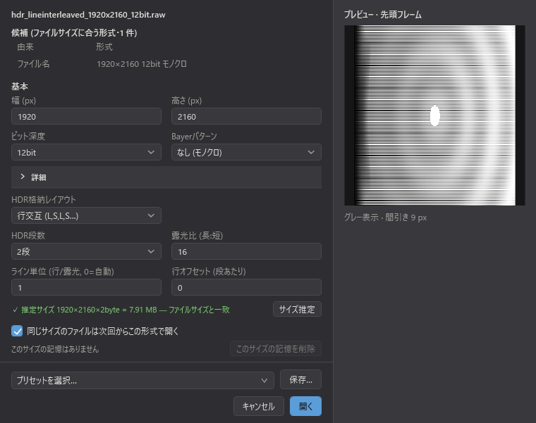
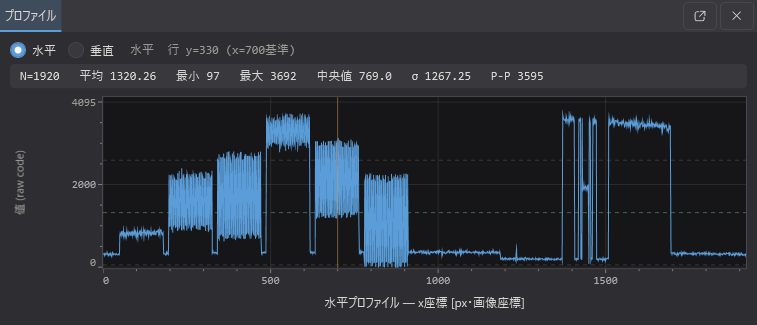

# RawAnalyzer 仕様メモ

README から外した細かな挙動のまとめ。操作できない場面では、アプリが理由を表示します。

## 値の扱い

- 画素は内部で 16bit に正規化する。N bit の code は `code << (16−N)`(8bit も WIC 経由も同じ)。統計・表示は元の code で示す
- ビット深度の違うページ・ファイルへ送るとき、黒 0・白最大の既定レベルは送り先に合わせ、調整済みのレベルは 16bit 内部値で保つ
- ビニング・フィルタ・HDR 合成の結果は**正規化 16bit**(元の最大コードを 65535 へ写す。12bit の 100 → 1600、4095 → 65535)。
  白飛びは処理後も飽和として扱い、黒 / 白レベルも同じ倍率で写す
- ビニングの加算は 65535 で飽和し、階調は拡張しない。端数ブロックの右端・下端は捨て、出力寸法を実行前に示す。
  処理結果は 1 億画素以下・作業メモリ 1 GiB 以下
- 画像演算の結果は出力のコード格子へ丸める。欠陥補正値は元のビット深度のコードへ四捨五入する

## メイン画面の操作

- ウィンドウを狭めると、保存、射影、ROI・ラインプロファイル、ゼブラの順にツールバー右端の「…」へ移る。トグルのチェック状態と、無効時の理由は「…」でも確認できる
- 画像上のカーソル情報、ROI 情報、縮小レベルは、表示する内容があるときに表示する。縮小レベルは再生バーが出ているとき、その上へ移る
- 再生バーの「‹」「›」は前後 1 フレームへ移動する。キーボードでは Page Up / Page Down で移動し、Space で再生・停止する
- 欠陥画素検出では、フッター上段で補正方式を選んで補正し、下段から結果のコピー・CSV 保存・閉じる操作を行う
- チャネル分割と HDR 分割では、見えている各区画の左上にチャネル名・露光名を表示する。「表示をクリップボードへコピー」にもラベルを含む
- 情報・警告・エラーのダイアログは「本文をコピー」で全文をコピーできる。Enter で OK、キャンセルがある場合は Esc でキャンセルする

## Raw の設定の推定

候補は「同じサイズのファイルの記憶 → 表示中の画像 → 記憶からの推定 → ファイル名の `幅x高さ` → 一般的な解像度」の順。
同じサイズで使った設定が 1 つに決まれば設定画面なしで開き、ステータスバーにその旨を出す。
「同じサイズのファイルは次回からこの形式で開く」を外すと候補に出すだけになる。「このサイズの記憶を削除」で記憶を消せる。

## TIFF

開く前にヘッダを自前で読み、形式ごとに経路を決める(WIC が黙って誤った値を返す形式を避けるため)。

| 形式 | 経路 |
|---|---|
| 非圧縮 16bit グレー / CFA、ストリップ連続 | オンデマンド読み出し(メモリに展開しない) |
| 非圧縮の 8〜64bit グレー / CFA(10/12/14bit 詰め込み・符号あり・実数・タイル・BigTIFF・ImageJ 連続スタック)、WIC が読めない RGB(16bit 実数・符号あり整数・24/64bit) | 自前で復号 |
| 圧縮(LZW / ZIP / PackBits / JPEG / CCITT)の 8/16bit、RGB、パレット、CMYK | WIC |

- **複数ページ**: クラシック / BigTIFF の IFD チェーン(最大 10 万ページ)と ImageJ の `images=N` 形式。縮小 IFD(NewSubfileType=1)は数えない。
  表示するページだけを読む。統計・処理・保存は現在のページが対象で、現在ページでの元ファイル上書きは禁止。OME の Z/T/C は解釈しない
- **DNG / CFA**: 現像せず Bayer 値として開き、CFAPattern(ActiveArea 起点)から配列を設定する。本体が SubIFD の DNG も開く。
  可逆 JPEG 圧縮と 3 サンプルの LinearRaw は非対応
- **WhiteIsZero** は反転して開く(整数は 最大−値、実数は 1−値)
- **アルファ・多チャネルのグレー**: アルファは捨てる(関連アルファも割り戻さない)。多チャネルのグレーは先頭チャネルだけを使う
- 1/2/4bit グレーは 8bit として開く。Orientation は無視する
- **非対応**(理由付きのエラー): LZMA / Zstd / WebP / JPEG 2000 / JPEG XL / LERC、JPEG 以外の YCbCr、32bit サンプルの Predictor=2。
  自前復号の形式で圧縮されたものは、非圧縮なら読める場合にその旨を添える

### 32bit・実数・広いサンプルの換算

値域を調べて 16bit へ写し、対応関係と 1 code あたりの元の値を情報欄に出す。対応はページ・ファイルごとに決まる。

| 元データ | 対応 | 表示例 |
|---|---|---|
| 実数で最大 ≤ 1 | 0〜1 → 0〜65535 | `32bit実数 0〜1 → 16bit` |
| 最大 > 1(整数は 1 以下でも) | 0〜最大 → 0〜65535 | `32bit値 0〜4095.5 → 16bit (1code≈0.0625)` |
| 負値を含む | 最小〜最大 → 0〜65535 | `32bit値 -499.5〜3595.5 → 16bit (1code≈0.0625)` |

- 負のすそは切り捨てずに残す(code 0 は最小値を指す)。NaN・無限大は code 0 にし、その数を情報欄に出す
- RGB は 3 成分共通の値域で写し、チャネル間の比を保つ
- 画像演算の参照・ノイズ測定の 2 枚目は、対象と対応関係が同じときだけ使える
- WIC はこれらのサンプル形式を正しく返さないため、SampleFormat タグを自前で解釈する

## HDR

- 格納レイアウトは「行交互」「フレーム連結」で持つ(DOL / Staggered は露光の時間関係の名前で、画素の並びからは判別できない)
- **ライン単位**(1 露光あたりの連続行数)か**行オフセット**が奇数だと、ファイル上の行の偶奇が Bayer の並びと合わない。
  Raw 表示では Bayer カラー・カラー現像・チャネル分割・チャネル別ヒストグラム・デモザイク保存・自動 WB を止める。
  チャネルは HDR 分割、色は HDR 合成で確かめる
- 合成表示の黒 / 白レベルは合成画像の値域(黒レベルを引いた値)で始まる。Raw 表示へ戻すと元のレベルに戻る
- 16bit の合成画像は黒レベル未満を 0 に切るため、暗部の平均は上振れし σ は小さく出る。float raw は負値を残す
- 行交互の raw への画像演算は HDR のレイアウトを保つ。HDR 素材の欠陥補正・ビニング・フィルタは、露光ごとに分割して開いてから行う
- HDR 分割表示から保存した画像のサイドカーには、段の数・幅・露光を記録する(開き直しでの段の復元はしない)

## 射影・ラインプロファイル

- 向きは EMVA 1288 の流儀(結果を並べる軸で呼ぶ)。水平射影 = 各列を縦に平均して x 座標に並べたもの。
  平均する方向で呼ぶ流儀(HALCON の gray_projections など)とは名前が逆
- 画像全体でも全画素を読む(FPN を見るため間引かない)。統計は小数 2 桁、CSV / TSV は有効数字 9 桁
- チャネル分割表示では、ROI を置いた象限のチャネルだけで取る。ROI がなければ選んだチャネル全体。CSV には分割表示の座標と元画像の座標を並べる
- HDR 分割ビューでは段をまたぐ ROI と画像全体の垂直射影を断る。行交互 HDR の Raw 表示では水平射影を断る
- フレーム・ページ・ファイルを送ると、同じ位置・方向で計算し直す。範囲外になったら「範囲外」と出す

### グラフ操作

- ホイール: 拡大・縮小(`Shift` 横軸のみ、`Ctrl` 縦軸のみ、軸の目盛り上ではその軸だけ)。縦軸は 1 raw code 幅まで
- 左ドラッグで移動、ダブルクリックで全体表示
- 軸の右クリック: 全範囲 / 自動 / 最小・最大の指定 / 軸の書式(範囲・主 / 補助の目盛間隔・目盛線)
- 縦軸の手動範囲は方向・対象を変えても保つ。横軸の手動範囲は座標で保つ
- 拡大・移動は表示だけで、統計とコピー・CSV は常にライン / 射影全体が対象

## 保存・一括書き出し

- Raw 保存は詰め方向・エンディアンを指定できる(8bit は 1 画素 1 バイト)
- 一括の 16bit グレー TIFF は、内部の 16bit フルスケールで書くか、raw の code のまま(下詰め)で書くかを選べる
- MP4 は Windows 標準の H.264 エンコーダ(Media Foundation)を使う
- 1 億画素を超えるフレームが含まれると、PNG / JPEG・動画の一括書き出しはそのファイルを示して中止する

## 比較モード

- ドロップや「開く」で最大 4 枚を追加し、各ペインの「✕」で閉じる。画像の縦横比と表示領域に合わせ、最も小さく表示される画像の面積が最大になる配置を選ぶ
- ファイル名が収まらない場合は、先頭と末尾が最もよく一致する別のペインの名前と比較し、共通部分を「…」に置き換えて差分を強調する。ファイル名にポインターを置くとフルパスを確認できる
- 比較中のステータスバーには、画像の枚数と、アクティブペインのファイル名・寸法・ビット深度・倍率が出る
- 比較中は通常表示を対象にする操作(右パネル・解析・保存・送りなど)は使えない。各ペインの「⋯」にある「自動」「リセット」と比較バーの「条件を揃える」で調整する
- マルチフレームの raw と TIFF スタックは先頭フレーム / ページを表示し、ファイル名に `フレーム 1/N` などを添える
